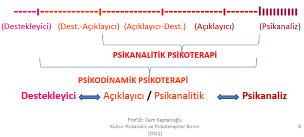

Bir önceki yazımda ruh sağlığı alanındaki önemli tedavilerden birisi olan **[destekleyici psikoterapi nedir](/destekleyici-psikoterapi-nedir)** anlatmaya çalıştım. Psikanalitik, psikodinamik, açıklayıcı, dinamik yönelimli psikoterapi, destekleyici psikoterapi gibi pek çok terim olması nedeniyle kafa karışıklığı oluşmuş olabilir, bu yazıda bu terimleri ve psikanalitik psikoterapinin temel özelliklerini ve destekleyici psikoterapiden farkını açıklamaya çalışacağım.

**Psikanalitik psikoterapi teorisini Freud’un psikanaliz kavramlarına ve Freud sonrası ortaya çıkan psikodinamik kuramlara dayandıran bir yaklaşımdır.** 

Bireysel psikoterapiler destekleyici psikoterapiden psikanalize uzanan bir yelpaze veya süreklilik olarak kavramsallaştırılabilir.

Açıklayıcı psikoterapi terimi, hasta ve terapist arasındaki ilişkilerin analizi ve daha önce tanınıp anlaşılmamış duygular, düşünceler, gereksinimler ve çatışmalarla ilgili içgörü gelişimi ve hastanın bilinçli olarak bu çatışmaları çözme ve daha iyi bir şekilde bütünselleştirme girişimi izleyen bir süreç yoluyla kişilik değişimini amaçlayan çeşitli yaklaşımlar için kullanılan ortak bir terimdir, bir tür psikanalitik psikoterapidir. Aşağıdaki resimde bireysel psikoterapiler yelpazesini ve terminolojik farklılıkları görebilirsiniz.

Hangi hastada hangi yöntemin seçileceği hastanın psikopatoloji düzeyi ve o anki gereksinimlerine göre belirlenir. Tedavi planları her zaman hastanın tedavi hedefleri dikkate alınarak şekillendirilir. **Hastaların çoğunluğunun tedavisi, uyumlu ve bütünleşmiş bir tarzda kullanılması gereken destekleyici ve açıklayıcı unsurların birlikteliğini gerektirir.**

Psikanaliz ve psikodinamik kuramlara sırtını yaslayarak çalışan psikanalitik psikoterapide amaç kişinin bilinçdışında bulunan ve kişiyi zorlayan bastırılmış konuların bilinç düzeyine çıkarılarak farkındalık, içgörü kazandırılmasıdır. **İyileşmenin içgörü kazanmaya ikincil olarak gelişeceği varsayımına dayanır. Bu yönüyle destekleyici psikoterapiden farklıdır.** Destekleyici psikoterapi doğrudan etki ilkesine dayanır ve iyileşmenin içgörü kazanmanın bir yan ürünü olacağı varsayılmaz.

Kazanılan içgörüyle beraber kişi anlamlandırmakta zorlandığı sorunları anlamlandırabilir, kendini hayatının kontrolünü tekrar ele alarak ve yaşantılarıyla yüzleşmiş olarak durumların sonuçlarını üstlenir. **Psikanalitik psikoterapi de genellikle haftada 1-2 kere, çoğunlukla belirlenen sabit bir gün ve saatte, 50 dakikalık görüşme şeklinde gerçekleştirilir.** **Psikanalitik psikoterapi kısa süreli bir psikoterapi değildir.** Terapinin süresi ve görüşme sıklığı kişiden kişiye, psikopatolojinin ağırlığına göre değişmektedir.

  

    <svg viewBox="0 0 24 24" fill="none" stroke="currentColor"><path d="M12 16V12M12 8H12.01M22 12C22 17.5228 17.5228 22 12 22C6.47715 22 2 17.5228 2 12C2 6.47715 6.47715 2 12 2C17.5228 2 22 6.47715 22 12Z" stroke-linecap="round" stroke-linejoin="round"/></svg>
  

  

    
Bu yazı genel bilgilendirme amaçlıdır. Şu anda haftalık seanslarla yürütülen yapılandırılmış psikoterapi için yeni hasta kabul edemediğimden, psikoterapiye ihtiyacı olan hastalarda uygun yöntemi belirleyip o yöntemle çalışan bir uzmana yönlendiriyorum.

  

